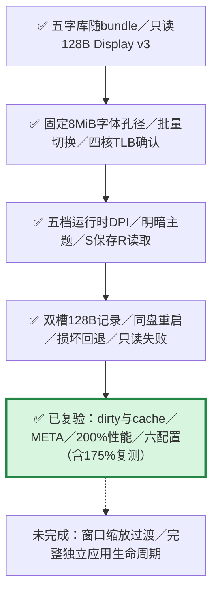
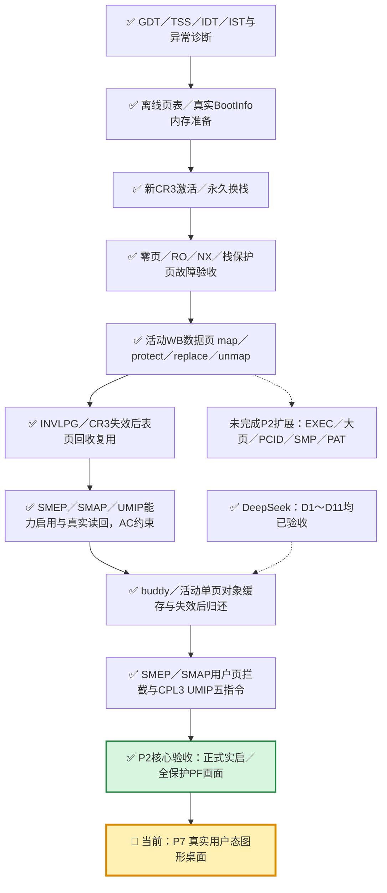
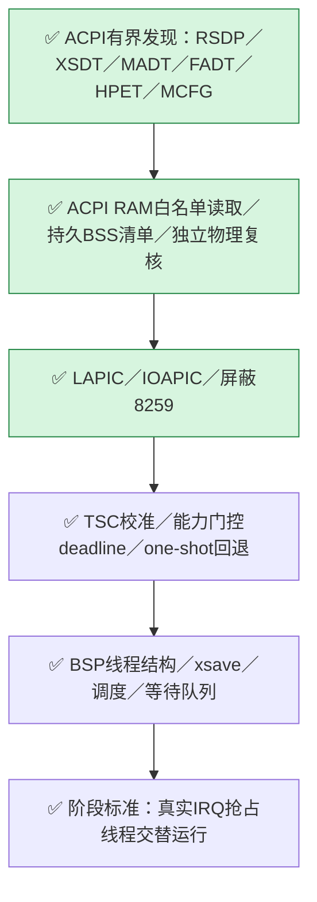

2026-10-24T17:25:08+08:00 P2接续完成一个组件：P2LEDGER44已独立验收并集成rev9；正式六组9tests/0skip，source_stable且进程停止/退出。真实memory+paging账本在debug/release合计20正常场景与10真坏Dong拒绝；R1完整runtime7 release构建339输入、99暂存内核源、7产物SHA一致，kernel=1,978,768B，2MiB窗口余118,384B。P2REG45亦integrated6，旧启动/桌面回归夹具正式2tests/0skip。未执行新镜像客体运行，P2整体仍partial：下一步C/D实际接线及客体正负证据，另有暖PCID实际复用和无真机条件下的物理WC待验。DeepSeek继续本人P2VEC42，P2ERR43依赖前项验收。
证据：coordination/dongos_works/reviews/2026-10-24-P2-ledger-verification.json、2026-10-24-P2-ledger-native.json、2026-10-24-P2-ledger-build.json；契约：code/docs/p2-framebuffer-ledger.md。以下为历史检查点。

2026-10-24 17:17 +08:00 P2：P2REG45已integrated rev6（两项旧回归夹具独立2tests/0skip）。P2LEDGER44已实现独立授权账本并submitted rev6，R1补HHDM溢出前置拒绝，正式冻结作业85481e0d327745dab512a9a646576cf5运行中，尚未验收/集成。前轮本机18正常+10真坏源通过；原正式作业主动取消，不算通过。R1前runtime7构建成功（kernel 1,978,768B），R1同源构建进行中。DeepSeek已领取P2VEC42 rev7，P2ERR43待前项验收；不抢占其文件。P2整体仍partial，C/D实际接线、warm-PCID与真机WC保持待验。

2026-10-24 最新改派：按用户要求，LM Studio运行已取消并停止；P2VEC42（rev6）与P2ERR43（rev2）负责人均已改为DeepSeek，状态todo待Harness领取。保留稳定ID lmstudio:P2VEC42/lmstudio:P2ERR43及原write_paths，前缀不代表当前负责人；先完成P2VEC42独立验收，再执行依赖项P2ERR43。独立测试仍由Codex维护。P2LEDGER44保留Codex负责，尚未实施。

2026-10-24 P2接续：L3/L3A完整纯ELF矩阵已完成。P2仍partial；ROOT13/PCID12/WC14/EXEC19/CACHE20/RAW38/OBS36/LARGE16均已集成。当前剩独立GOP授权账本（P2LEDGER44已发布未实施）、C/D实际接线、暖PCID实际复用证据及真机WC。LM Studio按单并发执行P2VEC42边界向量，随后P2ERR43错误码对照；Codex编写的独立校验门P2LMTEST41已integrated rev6（4tests/0skip）。数据交付不能替代生产/客体验收。以下均为历史检查点，状态以协调器最新rev为准。

2026-10-23 09:40 +08:00 有界检查点（P2SYNC40，尚待独立文档门）：**P2软件仍partial，P5本轮未实施**。
OBS36 submitted rev12：正式71项零skip；历史R5仅诊断observations_completed，acceptance/passed均false。
B R8正式44项零skip、两份fresh各1109source/staged与286产物、kernel1966480B；
实际normal-r8仍false（B已complete、后续service barrier pending），omit-r8首ps超时且未触发B，不是精准负控。
**B R9 in_progress rev36，未测/未通过**；normal v2区分后续pending，negative原门保持，验收/集成待后续。
C/D接线、PCID实际复用/wrongtag及真正WC仍未闭；P5CTX1/2旧组件保留。
暂无真机，待验留档不阻断P2软件及本机门完成后进入P5；全部软件/本机复验后上传GitHub并关机，末端操作尚未执行。
详见[09:40证据与边界](../../coordination/dongos_works/codex-works/reviews/2026-10-23-P2-historical-progress.md)、[来源JSON](../../coordination/dongos_works/codex-works/reviews/2026-10-23-P2-historical-progress.json)。
以下07:50及更早正文逐字保留，仅代表当时范围，不被本检查点改写。

---

# DongOS 整体任务图

2026-10-23 07:50 +08:00 检查点：最终范围为 **P2、P5 全部软件工作及本机复验**。
暂无真机，物理 WC 等待验项留档；P2 软件及本机门完成后可进入 P5，不能写成真机通过。
完成后完整代码上传 GitHub 并关机已获授权，末端操作尚未执行。
**OBS32/SYNC33/OBS34 integrated rev6**；OBS34 正式 36 项零 skip，仅集成 IO 证据组件。
LARGE16 的 R6 正式 37 项零 skip 与新源两构建通过，但实际 normal-r4 首个 ps 仍超时：
暂停内审计 4453ms、总 stop→cont 4688ms；cont 后落盘有效，原 1 秒期限问题未闭。
**LARGE16 in_progress rev26、OBS36 in_progress rev2**，接续历史镜像/R7 适配尚未测试。
P2 软件仍 partial，P5 本轮只读准备、尚未开始实现；原失败和中断不覆盖。
详见[有界进度与证据](../../coordination/dongos_works/codex-works/reviews/2026-10-23-P2-deferred-capture-progress.md)、
[来源 JSON](../../coordination/dongos_works/codex-works/reviews/2026-10-23-P2-deferred-capture-progress.json)。
下方 06:32/05:55/05:42 均为各自源码和授权范围的历史记录。

2026-10-23 06:32 +08:00 检查点：**SYNC31 integrated rev9、GOP29 integrated rev6、
HARNESS28 integrated rev6、BKL30 integrated rev9**，各正式独立回执均零 skip、
源码稳定且进程已停止/退出。BKL R1 失败保留；R2 为 3 项通过，FIFO 组件尚未接入 Bridge。
**OBS32 submitted rev3，LARGE16 submitted rev16**：修复采集 epoch 与五个忙进程
实际提交后才发起一次 request 的活性条件；OBS 29 项、LARGE 20 项本机预检通过，
完整独立复验未执行。
旧 31 项及构建仅属各自历史源码。
R13 的 AP 空闲/屏蔽计时快照不构成 AP 用户计时门通过，也不能据此认定硬件限制。
P2 仍 **partial**，P5 本轮尚未开始；实际大页/EXEC/受控 PF/缓存接线、暖 PCID 与
物理 WC 门继续保留。详见[本次状态与原始证据](../../coordination/dongos_works/codex-works/reviews/2026-10-23-P2-observer-progress.md)
及[机器可读记录](../../coordination/dongos_works/codex-works/reviews/2026-10-23-P2-observer-progress.json)。下方 05:55/05:42 为历史快照。

2026-10-23 05:55 +08:00 追加：**SIZE23 integrated rev6，SMP27 v2 integrated rev9**。
R13 在首次暂停前连续运行2秒、之后不再恢复，Domain.failed=0、无首错，三个AP
实际用户进入161/168/213次，完整16槽（11个live根）池审计通过。旧采集在大量
QMP读取后恢复，存在WHPX绝对期限被观察过程扰动的风险；先修采集方法，不能
直接归责生产锁。AP计时仍0，暖PCID及实际事务余项未关闭，P2仍partial，完成后
再进入P5。详见[05:55追加与原始证据](../../coordination/dongos_works/codex-works/reviews/2026-10-23-P2-lock-diagnostics.md)，下方05:42状态为历史快照。

2026-10-23 05:42 +08:00 检查点：继续按 **P2 → P5** 执行，P2 保持 partial，
P5 本轮尚未开始。SIZE23 已正式独立 99 项零 skip，LARGE16 已正式独立 31 项
零 skip；正常/负控两份实际构建均为 1,962,384B，但实际 WHPX 仍出现获取
内核锁超时，AP 用户进入/计时/切换仍为零，故两任务尚未验收/集成。
HARNESS24 已集成；SMP27 时间诊断 v2、HARNESS28 夹具、GOP29 永久绘图
Gate、BKL30 FIFO 组件继续复验或实现。完整 C/D/ledger 接线、实际大页/受控
PF/缓存迁移/暖 PCID 与物理 WC 门禁仍须通过。详见[锁诊断与当前状态](../../coordination/dongos_works/codex-works/reviews/2026-10-23-P2-lock-diagnostics.md)。
下方旧检查点、任务数量及“当前/未运行”保留各自日期和源码范围，不覆盖本次状态。

2026-10-23 当前顺序：**先完成 P2，再完成 P5**。P2 仍 partial；ROOT13/MASK18、
PCID12/WC14 严格采集准备、EXEC19/CACHE20 组件已各自集成，ENTRY21 和
DISCOVERY22 也已独立复验并 integrated rev6。LARGE16、SIZE23、HARNESS24
及完整服务接线/实际 AP/PF/缓存迁移/物理 WC 门禁仍在接续。P5 本轮实现尚未
开始，G6DOC1 保持 paused rev2。逐项状态与真实运行失败见[本轮 P2 进展](../../coordination/dongos_works/codex-works/reviews/2026-10-23-P2-runtime-progress.md)。
下方旧日期、数量及“本轮未运行 OS/VM”属于各自原检查点。

2026-10-23 G5 收尾：**G5FULL1 integrated rev16、G5CLOSURE1 integrated rev21，
G5INT1 integrated rev24**。七个生产模块已真实写入本地主线工作树并独立复验；
正式作业 `0856b466a4d44a13be901c02f8acff46` 的 51 项完整语言矩阵、1 项闭包和
18 项关联回归共 **70 项全部通过，零 skip**，源码稳定、进程停止及退出均确认。
完整矩阵覆盖 27 组要求，`scope_complete=true`；两模式四份编译器 ELF
逐字节相同，每份 2,046,376 字节，56 MiB arena / 64 KiB 栈 / 2 MiB ELF
预算保持。详细原始证据、失败历史及实际状态见 [完成回执](../../coordination/dongos_works/codex-works/reviews/2026-10-22-G5-completion.md)，
永久入口见 [G5 门禁](g5-differential.md)。

G5 完成范围为语言/ABI 的 frontend → lower → NASM 执行及宿主有界自编译
闭包；内建汇编器仍有明确指令范围，Win64 XMM、原子及受限 asm 的完整
NASM 覆盖不等于任意程序均可由它生成 ELF。扩大后的编译器须另做新 G6
客体自编译、持久化和同盘双启；历史 G6 仍只绑定原 head / 49 模块 profile。
因此 L3 整体及更广纯 ELF 后端继续保留各自余项，P2/P5/P6/P7/P8、KVM/
真机和 P9 门禁不因本次完成而关闭。本轮未运行 OS/VM，未提交或推送。

以下保留各自日期和源码范围的历史记录；旧 164 项数量、旧 G5 缺口和
“当前/待完成”不再代表最新状态。实时任务数量见协调器及协作区整体任务图。

本轮17份缺失任务书、CX6同号异义和CX14/CX15旧状态均已处理完成。CX14 integrated rev7，CX15 integrated rev8；CX6 integrated rev9，已恢复读取器契约，分离5条原NASM事件，耗时恢复为1轮/265秒，原始事件全部保留。协调器issues=0；核对时间2026-10-22T09:18:41+08:00。

当前MCP快照共164项活动任务：19 accepted、140 integrated、3 submitted、1 in_progress、1 rework。本轮同时观测到其它客户端新增5项并行任务，其状态按实时MCP继续变化，本轮没有接管或改动它们。

完整阶段表及证据见[整体任务图](../../coordination/dongos_works/progress-map.md)与[恢复报告](../../coordination/dongos_works/reviews/2026-10-22-task-recovery/README.md)。

以下保留原有记录；其中日期、任务数量、机器路径和“当前/下一步”均属于各自历史检查点，最新状态以上述记录及协调器为准。

最新接续（2026-10-21T23:25:35+08:00）：P2BUILD5已独立验收并本地集成rev6：正式16项零skip/source_stable；补齐正式构建NASM分组帮助探测，真实NASM2/3兼容测试通过。NASM3完整release runtime7构建、实际1/4核共享大页与四核桌面/P5两观察、独立raw replay均通过。正常kernel2006608B/余90544B；316inputs匹配主目录。与旧NASM2非逐字一致，19ASM源相同，编码/对齐差异已审查并保留双份证据。MCP快照132项=109 integrated+19 accepted+3 in_progress+1 todo。Claude EXEC in_progress rev10（R1返修），WC in_progress rev2；DeepSeek L3A在途rev2，L3待依赖验收。P2 EXEC/WC消费者、任意调度后多CR3及WC真实性能仍未关闭。不提交/推送/建PR。 见[整体任务图](../../coordination/dongos_works/progress-map.md)和[P2BUILD5集成回执](../../coordination/dongos_works/reviews/2026-10-21-P2BUILD5-integration.json)。

2026-10-21 02:26 历史G6检查点（由顶部本地快照接续）：原main合并/同步检查点19e1a19及准确候选真实双启证据保留；GitHub新push状态本轮未重新查询，不能将旧in_progress快照当作当前状态。详见[G6执行/合并报告](../../coordination/dongos_works/reviews/2026-10-21-g6-ci-execution.md)。

2026-10-20 23:28 历史检查点（由顶部取代）：主线仍为244b18c；C52新正式复验6项/0skip、149.843秒后accepted rev13→integrated rev14，CXNASM3正式10项/0skip、2.859秒后accepted rev5→integrated rev6，两者source_stable/process_stopped/execution_exited均true，真实代码早随PR8合入。新增手动Cursor任务P5CTX1 todo rev1，7项write_paths全部在本人works副本，验收后由Codex实际集成，根kernel禁止worker直改。当前122项活跃任务（102 integrated、19 accepted、1 todo、0 submitted），总138项含16归档；foreign161仍不导入。23:13“DB未变”的[合并同步冻结报告](../../coordination/dongos_works/reviews/2026-10-20-pr8-merged-local-sync.md)保留当时证据，本轮通过正常新rev和新任务继续推进，没有覆盖历史。P5 partial、L3B complete、L3C partial保持；G6 runner准备条件已核清，但CI尚未接入或运行，report目录的workflow提案不代表已生效，不等完整P5。合并后完整CI39444684378仍运行。详见[最新整体任务图](../../coordination/dongos_works/progress-map.md)及[本轮P5/G6安排](../../coordination/dongos_works/reviews/2026-10-20-p5-g6-next-actions.md)（报告及静态提案已保存，workflow未安装或运行）。

2026-10-20 入口更新：当前 P0–P9 / L0–L3 状态请查看 [协作区最新任务图](../../coordination/dongos_works/progress-map.md)及其 [roadmap.json](../../coordination/dongos_works/roadmap.json)。按 [P5/P6 工程交接](p5-p6-engineering-handoff.md#接手顺序与停止条件)，当前优先推进 P5；L3 宿主编译链与客体自编译门禁见 [语言线当前记录](language-l2-l3.md#l3-完成路径与当前门禁2026-10-21)。协作任务状态以协调器实时查询为准。

21:31 历史快照（已由顶部23:28当前记录取代）：当时PR#7已合入远端main，PR#10完整CI通过待合；PR#8仍有CI/本地状态重叠及客体桥缺陷，PR#3独立暂缓。当时远端main为`1dfebe1`、本地检出为`345570f`；[历史GitHub快照](../../coordination/dongos_works/reviews/2026-10-20-roadmap-github-checkpoint.json)仅用于追溯，不代表当前状态。

以下保留 **2026-10-17 历史快照**，用于追溯当时验收范围。图中的 PCID 待补、P8 待做及 L2/L3 未完成等文字均为当时状态，不代表当前进度；后续实现、已记录证据与待验收环节以以上最新版入口为准。

更新于2026-10-17。**P7运行时五档DPI与双槽主题持久化已实现并复验**：27项宿主检查零skip，五次设置客体加六种桌面配置共11个场景通过；正式12次启动含175%首次时钟校准离群失败及相同镜像一次复测通过，原失败保留。运行时200%拖动59.9420FPS、最慢8.7174ms。总记录为`build/test/p7-settings/validation-summary.json`。P7窗口缩放过渡、独立应用生命周期及P6通用调度/DAG/KVM快启仍未完成；时钟单窗口校准抗抖动为已记录的后续问题。见[桌面记录](graphical-desktop.md)、[四核记录](smp-runtime.md)和[完整计划](../PLAN.md)。

```mermaid
flowchart LR
    P0["✅ P0 工具链／UEFI入口"] --> P1["✅ P1 引导器"]
    P1 --> P2["✅ P2核心验收通过／扩展未完成"]
    L1["✅ L0／L1 语言与基础库"] --> P2
    P2 --> P3["✅ P3 ACPI／中断／抢占线程"]
    P3 --> P4["✅ 百万IPC／PCID和init待补"]
    P4 --> P5["✅ 三个CPL3服务／双启动文件持久化，详细项未全完"]
    P5 --> P6["部分通过：P6 四核／TLB，调度与快启待补"]
    P6 --> P7["📍 P7运行时DPI／双槽设置已复验"]
    P7 --> P8["待做 P8 USB／真机"]
    P8 --> P9["待做 P9 安全加固"]
    P9 --> P10["后续 P10 持续完善"]
    style P2 fill:#d7f5df,stroke:#238645,stroke-width:2px
    style P3 fill:#d7f5df,stroke:#238645
    style P4 fill:#fff0b3,stroke:#d68a00,stroke-width:3px
```

本轮P7接入与验收：

设置证据：`build/test/p7-settings/qemu/run-25bd369c2690/result.json`，五次正式启动；总记录`build/test/p7-settings/validation-summary.json`包含27项宿主检查、六配置回归和175%首次校准异常的失败与复测记录。聚焦设置窗口用 `-` / `=` 循环五档、`T` 切换主题、`S` 保存、`R` 读取；启动优先有效 `DESK0.CFG` / `DESK1.CFG`，否则使用镜像的 `--scale` 默认。双槽保留旧有效记录，写入经FLUSH和完整回读后发布新序号，不承诺物理掉电时的FAT原子性。历史性能见桌面文档的历史段落。

P2内部进度：

原runtime0路径仍限BSP；runtime6/7已接入保持在线的AP与IPI应答屏障。修改者仍是BSP、IF/AC关闭、PCID/PGE关闭，数据页保持WB/NX；支持的SMEP/SMAP/UMIP控制位已开启。新Owner已连接buddy→活动映射→定长对象→全空撤销/失效→归还，含失败保留与重试。独立测试镜像已完成用户页SMEP/SMAP拦截、AC放行及真实CPL3 UMIP五指令拒绝/关闭对照；没有扩展生产USER/EXEC接口或引入用户服务。多核shootdown已通过；动态执行别名、大页、PCID及PAT扩展继续保留。实现与证据见[权限专项](user-permissions.md)、[对象缓存集成](page-cache.md)、[CPU硬化记录](cpu-hardening.md)、[活动页表记录](active-paging.md)，首次激活记录见[paging-activation.md](paging-activation.md)。

P3内部进度：

ACPI表在旧P1低4GiB映射退役前读取，清单复制到内核BSS后供新CR3使用。随后runtime3启动APIC与定时抢占，正常、无HPET、无XSAVE及正式版四配置均通过；有界证明结束后停timer并清IF返回原continuation。以上是P3独立证明的终态；runtime6/7随后已启动并保持AP在线，runtime4/5/7已接入用户服务。详细证据见[ACPI记录](acpi-discovery.md)与[P3运行时](interrupt-runtime.md)。

DeepSeek：D1～D11均已验收。14:19复验确认D10最后一处count后即时BG已有效，永久两项通过、零skip，唯一旧坏写控制两模式均立即拒绝、0漏检，详见[最新验收](../../coordination/dongos_works/deepseek-works/reviews/2026-10-17-acceptance-1419.md)。原有限剩余全部关闭；P2核心现已验收，五项扩展继续保留，本轮不增加DeepSeek任务编号。

语言线L2（优化与调试信息）计划与P3～P6并行；L3（自举）在P5之后，均尚未进入本地完成阶段。
