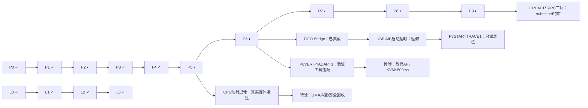

# DongOS 整体任务图：当前检查点

更新时间：2026-11-06T15:31:40+08:00。当前状态来自协调器；历史远端CI未重跑。

FIFO Bridge生产接线、Windows USB策略LF和P5源码绑定修复已独立验收集成；P5正常/故障真实四核客体及原始重放通过，CPU映射退休门关闭。USB新旧Bridge均files/settings启动超时，完整HID/文件/双启动仍未通过。P2/P5/P6/P7/P8/P9保持partial，L0–L3既有结论不变。

## 阶段总览

|阶段|状态|当前剩余门|
|---|---|---|
|P0 工具链与构建环境|已验收|保持既有验收范围|
|P1 UEFI 引导器|已验收|保持既有验收范围|
|P2 CPU 与内存|部分完成|PCID12入口已集成，暖tag/同槽跨代复用与真实全读者失效仍需独立支持环境证据；TCG回退不能替代。；物理显示WC吞吐及有效内存类型的真机验收仍未提供；既有USB/启动诊断或VM结果不能替代，不再沿用旧快照的暂无真机假设。；P2PCIDWHPX1 rework5：既有两次严格WHPX在OVMF PlatformPei #GP，尚未进入DongOS；保留失败，不以TCG代替暖PCID证据。|
|P3 中断与抢占线程|已验收|保持既有验收范围|
|P4 用户态与 IPC|已验收|保持既有验收范围|
|P5 基础服务|部分完成|设备outstanding DMA可信排空/停止和第三方owner排除仍未证明；held=1、PINNED保持、drain=UNKNOWN，不得据CPU页表退休授予unpin/free/reuse。；取得硬件安全前提后再实现精确回收、重绑定及驱动恢复，并完成同boot故障与脏DMA/晚IRQ/存储持久化负控。；partial mapping、physical=0及准备/退休失败已有宿主负控；对应真实客体故障注入仍待执行。|
|P6 多核与快速启动|部分完成|init首代跨AP依赖图并行结构证据仍未闭环；旧PR#3/KVM失败保留，不用启动完成后的AP活跃代替。；2026-11-06完整USB回归新旧Bridge均files/settings启动Timeout05110007，尚未进入HID/文件/第二启动；P678USBBAS2 rework11，P8BOOTCONSOLE1 rework17，原长文件问题未关闭。；合法Linux/KVM上的loader→interactive shell≤500ms原门仍待验，TCG/宿主计时不替代。；P6VERIFYADAPT1 todo1：修正旧分支7产物/零静态池/当前仓库CI准入适配；旧分支不整支合并。|
|P7 图形桌面|部分完成|P7STARTTRACE1 todo1：以只读、绑定源码的超时前观察区分files/settings的window/font/FS/块设备阶段；LIST重复扫描只是源码线索，尚未证明为本次超时根因。；最新源码的完整GUI/输入及桌面稳定性回归；既有P8RUNTIME1/P8BOOTLOG1旧镜像通过不能覆盖后续变更。；P8BOOTCONSOLE1候选虽曾单次启动/交接PASS，仍有runtime fatal及HID/文件失败未闭环；需排除后再验收当前连续桌面。|
|P8 USB 与真机|部分完成|P678USBBAS2 rework11：正常runtime7 USB-only新旧Bridge A/B均files/settings启动超时；六个64MiB内部保护虚盘实际完整hash未变且客体均清理。失败未到HID/文件/双启动，不能替代原长文件回归。；codex:P8BOOTCONSOLE1 rework rev17：保留runtime fatal及完整HID/文件失败；单次启动和实验诊断版发布不代表稳定或真机根因已修复。；Intel真机新版PSI各word与scratchpad/连续桌面/USB键鼠/文件持久化仍须实际复测；至少台式机、笔记本各一台的原阶段门保持。；USB设备、Hub及更多层级覆盖和最新镜像完整集成回归未关闭。|
|P9 安全加固|部分完成|P9CPL3RUN1、P9HOSTCRT1、P9IPCEXEC1均submitted rev4且宿主正式复验通过；真实CPL3完整UART/ELF身份与IPC活端点候选仍待独立源码及原始证据审查，未登记验收。原4096B环/完整20704B批与UART丢输出风险需由完整外部捕获证据覆盖。；真实系统调用/IPC模糊测试、泄漏监控与原阶段24小时运行门未完成；宿主回执不提供guest attestation。；用户密钥签名与OVMF/真机安全启动，IOMMU隔离用户DMA，CET影子栈/间接跳转保护及内核基址随机化仍待完成。|
|L0 语言规格|已验收|保持既有验收范围|
|L1 编译器与基础库|已验收|保持既有验收范围|
|L2 优化与源码调试|已验收|保持既有验收范围|
|L3 Dong 编译器自举|已验收|保持既有验收范围|
|L3A 完整后端与命令行|已验收|保持既有验收范围|
|G5 完整语言/NASM宿主门禁与有界自编译闭包|已验收|保持既有验收范围|
|L3B 宿主有界自编译固定点（已进入主线）|已验收|保持既有验收范围|
|L3C DongOS内自编译（runtime5/49模块profile）|已验收|保持既有验收范围|
|M0 已包含的历史分支：6项，无需重复合并|已验收|保持既有验收范围|
|M7 PR#7：远端已合，本地主线已包含|已验收|保持既有验收范围|
|M10 PR#10：已合入远端与本地主线|已验收|保持既有验收范围|
|M8 PR#8：已正常合并并同步本地主线|已验收|保持既有验收范围|
|M11 PR#11：G6代码已合并/同步，限定profile验收完成|已验收|保持既有验收范围|
|M3 PR#3：独立暂缓合并（工具已开发）|未开始|不在M7→M10→M8合并队列；focused39425166102的KVM权限及首代DAG观察失败，应解决环境/观察门禁或另拆工具范围；保留真实失败，未取得KVM计时或首代结构成功证据前不标阶段验收通过|
|C52 C52：新正式复验并登记集成|已验收|保持既有验收范围|
|CXNASM3 CXNASM3：NASM兼容维护正式集成|已验收|保持既有验收范围|
|P5CTX1 P5CTX1：精确持有上下文已本地集成|已验收|保持既有验收范围|
|P5CTX2 P5CTX2：真实客体持有上下文核验已集成|已验收|保持既有验收范围|
|P2LIVE1 P2LIVE1：正常根BSP活动大页已集成|已验收|保持既有验收范围|
|P2SIZE2 构建函数节与内核GC预算（本地集成）|已验收|保持既有验收范围|
|P2SMP3 共享根大页同步与永久持有视图（本地集成）|已验收|保持既有验收范围|
|DS-L3A DeepSeek L3A：可变全局量原生闭环|已验收|保持既有验收范围|
|DS-L3 DeepSeek L3：G5整程序差分回归|已验收|保持既有验收范围|
|CL-P2EXEC1 P2EXEC1：动态执行别名事务（Codex接手并本地集成）|已验收|保持既有验收范围|
|CL-P2WC1 P2WC1：WC缓存迁移事务（Codex接手并本地集成）|已验收|保持既有验收范围|
|P2OOM4 真实碎片order9 OOM拒绝（本地集成）|已验收|保持既有验收范围|
|P2BUILD5 正式构建NASM3能力探测（本地集成）|已验收|保持既有验收范围|
|P2ALIAS8 P2正常EXEC/GOP WC硬件消费者|已验收|保持既有验收范围|
|L3PTR7 原生前端合法全局静态取址|已验收|保持既有验收范围|
|P2SIZE9 正式内核现有O1策略|已验收|保持既有验收范围|
|P2SIZE10 正式服务内核显式static2存储配置|已验收|保持既有验收范围|
|L3REG11 L3A旧GLOBAL/.data主线兼容|已验收|保持既有验收范围|
|L3MAIN12 有限G5差分runner主线入口集成|已验收|保持既有验收范围|
|L3HOST13 L3A测试桥实际跨宿主发布门禁|已验收|保持既有验收范围|
|L3REG14 旧native测试零参数容量边界|已验收|保持既有验收范围|
|P2CD1 C/D生产接线与真实客体复验|已验收|保持既有验收范围|
|P2CDTYPE1 PAT×MTRR有效缓存类型|已验收|保持既有验收范围|
|P2CDBUILD1 零静态池构建身份适配|已验收|保持既有验收范围|
|P2VEC42 GOP页包络向量（Codex接手）|已验收|保持既有验收范围|
|P2ERR43 缓存错误码对照（Codex接手）|已验收|保持既有验收范围|
|RECOVERY22 新开发机原任务恢复、身份分离与旧状态收尾|已验收|保持既有验收范围|
|P5RECBOUND1 P5恢复事务边界修复|已验收|保持既有验收范围|
|P5DMAINT2 P5 DMA准备及映射退休生产集成|已验收|保持既有验收范围|
|P9GUESTINT1 P9有界消费与原始回执生产集成|已验收|保持既有验收范围|
|P5P9CALLINT1 P5真实生命周期与P9日志传输集成|已验收|保持既有验收范围|
|P8PSI1 USB标准PSI兼容及配套授权|已验收|保持既有验收范围|
|P8BOOTCONSOLE1 连续真机启动与屏幕日志：返修|部分完成|当前rework rev17；runtime fatal、HID/文件及真机稳定性未闭环。|

箭头表示研发推进关系，具体领取依赖仍以协调器depends_on为准。

## 本批验收与失败记录

|任务|状态|正式检查数|
|---|---|---|
|cursor:P6BKLBRIDGE1|integrated rev7|4，零skip|
|codex:P6BKLINT1|integrated rev6|31，零skip|
|codex:USBLF1|integrated rev6|7，零skip|
|codex:P5SOURCEBIND1|integrated rev6|24，零skip|
|codex:P5RETIREGUEST1|integrated rev7|24，零skip|
|codex:P678USBBAS2|rework rev11|未登记通过|
|cursor:P6VERIFYADAPT1|todo rev1|未登记通过|
|cursor:P7STARTTRACE1|todo rev1|未登记通过|

P5故障32PTE全零、四核新ACK和身份一致已独立重放；PINNED1、held1、drain0保留，不授予设备排空、页复用或恢复。USB两个A/B均files/settings 05110007，未走到HID/长文件/二次启动；旧失败档案保持。

[本批审查、命令、指纹及回执索引](reviews/2026-11-06-p5-p6-checkpoint.json)。原始build/虚盘/物理转储留本机，换机需另行转移或重跑，Git摘要不是原始证据。

## 下一步

1. Cursor手动执行P7STARTTRACE1，定位USB启动超时前阶段；不得延长期限或伪造READY。
2. Cursor手动执行P6VERIFYADAPT1，适配现有manifest/零静态池/仓库CI；不整支合入过期验证分支。
3. 独立审查P9CPL3RUN1、P9HOSTCRT1、P9IPCEXEC1的现有提交与原始客体证据，再决定验收。
4. P5设备DMA安全前提、P2暖PCID/物理WC、P6合法KVM和P8两类真机、P9长期安全门分别推进。

## 实时任务快照（非归档）

共281项：accepted 24, integrated 247, rework 3, submitted 5, todo 2。此数量绑定上述时间。

|未登记集成任务|状态|说明|
|---|---|---|
|claude:C1|accepted rev4|任意精度有符号除法和余数|
|claude:C2|accepted rev4|任意精度位运算和移位|
|claude:C3|accepted rev4|Dong AST 纯常量整数/布尔求值|
|claude:C4|accepted rev4|无分配的目标类型布局引擎|
|claude:C5|accepted rev4|原生单行诊断格式化|
|claude:C6|accepted rev4|原生 UTF-8 源码位置定位器|
|codex:G5ALIGN1|accepted rev5|G5 高对齐局部对象及真实组合栈预算|
|codex:G5EXEC1|accepted rev8|G5 函数指针、硬件内建、asm 与 Win64 执行闭环|
|codex:G5PANIC1|accepted rev5|G5 panic ABI、种类/路径/行号与前端诊断对齐|
|codex:G5TAG1|accepted rev5|G5 optional/result/error/enum 全流水线与差分闭环|
|codex:P2PCIDWHPX1|rework rev5|[P2] 当前 Windows WHPX 的严格逐 CPU PCID 复验|
|codex:P5P9AUDIT1|submitted rev3|P5/P9 接手候选的非作者独立审查与验收依据|
|codex:P678USBBAS2|rework rev11|[P6/P7/P8] 当前源码正常 USB 镜像的完整客体回归|
|codex:P8BOOTCONSOLE1|rework rev17|真机连续启动的屏幕日志与首用户态进度|
|codex:P9CPL3RUN1|submitted rev4|[P9] 真实 CPL3 语料执行与外部 UART 回执核验|
|codex:P9HOSTCRT1|submitted rev4|[P9] 修复原生语料夹具的 Windows 严格格式编译|
|codex:P9IPCEXEC1|submitted rev4|[P9] 真实 CPL3 实时端点 IPC 与故障取消回归|
|cursor:L3EXTUNSAFE1|accepted rev6|L3/G5返修：无体 extern 普通函数与方法漏默认 unsafe|
|cursor:P5RECBOUNDREVIEW1|submitted rev4|[P5] 独立审查恢复事务边界修复与原生负控|
|cursor:P6VERIFYADAPT1|todo rev1|[P6] 旧DAG/KVM验证工具适配当前构建与页池契约|
|cursor:P7STARTTRACE1|todo rev1|[P6/P7/P8] GUI READY前文件与设置启动超时的只读分阶段捕获|
|deepseek:D1|accepted rev12|原始字节内存模块|
|deepseek:D10|accepted rev11|固定对象缓存|
|deepseek:D11|accepted rev11|位集合|
|deepseek:D12|accepted rev4|线性arena|
|deepseek:D13|accepted rev4|严格UTF-8|
|deepseek:D2|accepted rev12|usize检查算术与对齐|
|deepseek:D3|accepted rev12|字节切片辅助模块|
|deepseek:D4|accepted rev12|原子自旋锁|
|deepseek:D5|accepted rev4|缓冲区与回调格式化|
|deepseek:D6|accepted rev4|x86-64外部汇编包装器|
|deepseek:D7|accepted rev11|特权级硬件探针|
|deepseek:D8|accepted rev11|物理伙伴分配器|
|deepseek:D9|accepted rev11|内存区间归一化|

历史阶段证据保存在[roadmap.json](roadmap.json)各阶段done/evidence及带日期notes；历史状态不覆盖本次快照。跨机流程见[CROSS_MACHINE.md](../CROSS_MACHINE.md)。
